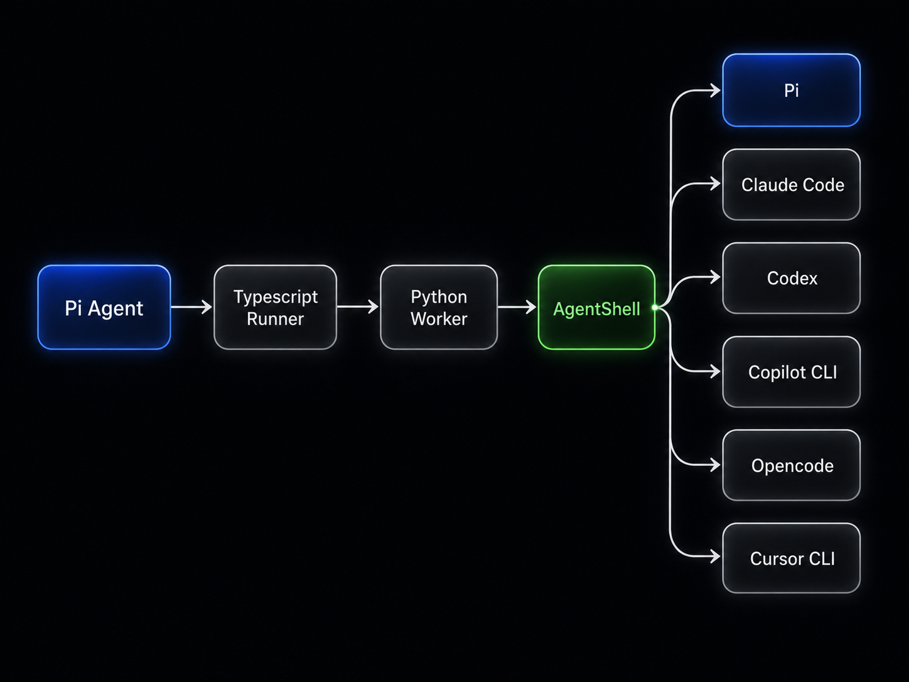

# Pi AgentShell Extension

A [Pi](https://github.com/earendil-works/pi) extension for delegating tasks to other coding
harnesses, including Pi, through [AgentShell](https://github.com/ScottRBK/agent-shell).


## Architecture



The TypeScript runner and Python worker execute delegated tasks through AgentShell. In TUI and RPC
sessions, a session-scoped job registry tracks background work and delivers completion as a
conversation message. JSON and print sessions wait inside the tool call and return its final result.

## Requirements

- Linux, macOS, or WSL2
- Pi
- [uv](https://docs.astral.sh/uv/getting-started/)
- Python 3.12 or newer, which uv can provide
- The chosen coding-agent CLI installed and authenticated, such as Codex, Claude Code, or Grok

## Installation

```bash
pi install npm:@scottrbk/pi-agentshell-extension
```

To install the latest source from GitHub instead:

```bash
pi install git:github.com/ScottRBK/pi-agentshell-extension
```

## Getting Started

The first time Pi starts with the extension installed, it will:

- Check whether `uv` is available
- Ask for permission to run `uv sync --locked --no-build`, which installs the AgentShell wheel
- Register the tool immediately after setup

## Usage

Once in a Pi session, you can ask it to delegate a task to another coding agent.

For example:

> Ask Codex to review this project and identify any bugs.

See AgentShell's
[list of supported agent types](https://github.com/ScottRBK/agent-shell#features).

The tool accepts the following parameters:

| Parameter | Required | Description |
| --- | :---: | --- |
| `agent_type` | Conditional | Harness, e.g. `pi`; optional for named/known resumed calls. |
| `roster_entry` | No | Child entry name from `subagent_roster`; applies its launch settings. |
| `task_name` | Yes | Display name, 1–40 characters. |
| `prompt` | Yes | Task given to the subagent. |
| `cwd` | No | Working directory; defaults to Pi's current directory. |
| `model` | No | Model identifier passed to AgentShell. |
| `effort` | No | Reasoning effort; supported values depend on the agent. |
| `resources` | No | Local resource selection; see [session rosters](docs/session-rosters.md). |
| `roster_file` | No | Pi-only child roster; omitted means ordinary default behavior. |
| `resume_session_id` | No | Returned native session ID; omit or use `null` for a new session. |
| `auto_approve` | No | Automatic tool approval; defaults to `false`. |
| `allowed_tools` | No | Tool allow-list; support varies by agent. |
| `disallowed_tools` | No | Tool deny-list; support varies by agent. |
| `interactive` | No | Native UI in a neighbouring tmux pane; default `false`. |
| `stay_open` | No | Keep an interactive pane after its result; default `false`. |
| `inactivity_timeout` | No | Seconds before inferred completion; default `60`. |
| `inactivity_enabled` | No | Allow inferred completion without a reliable agent event. |

AgentShell warnings are included in the completion message when an agent cannot enforce a control.

### Interactive Tmux Panes

Start Pi inside tmux, then ask it to launch a subagent with `interactive: true`. The native agent UI
opens in a pane to the right. Switch to that pane using your normal tmux bindings to watch progress,
answer permission prompts, or type steering directly to the agent. Headless delegation remains the
default. Requesting interactive mode outside tmux produces an error.

For example:

> Ask Codex to review this project in a tmux pane, and keep the pane open when it finishes.

Pi should pass `interactive: true` and `stay_open: true` for that request. Normally the pane closes
when the result is delivered. With `stay_open`, Pi receives the first result while the native UI
remains available for further conversation while the agent is running, or viewing after it exits.
Later turns in that pane do not send additional job results to Pi. Retained panes are closed when
their owning Pi session shuts down.

Completion uses a reliable agent event when available. Otherwise, the extension waits for sustained
inactivity: 60 seconds by default. Observable activity, including visible steering, resets the
timer. Recognised permission and login prompts prevent automatic closure. Inactivity is an estimate:
a quiet agent can still be working, and unfamiliar prompts or busy indicators may not be recognised.
Increase the timeout for tasks with long quiet periods. Results inferred from inactivity carry a
warning.

Structured answer text is returned when available. Otherwise, the result contains a labelled
terminal capture, which can include interface text and may omit output that has scrolled away.

**Known constraint: interactive Codex uses terminal capture.** Its completion notifications can
contain a background-generated title instead of the requested answer. As an interim measure, the
extension ignores those notifications and returns terminal text after sustained inactivity, using
the same configurable 60-second default. New interactive Codex runs do not return a verified session
ID for resumption. Monitoring, steering, and `stay_open` remain available.
Headless Codex is unaffected.
With `inactivity_enabled: false`, these runs wait for process exit or cancellation instead of
inferred completion. Process exit alone is not treated as a successful answer.
Track removal of this workaround in [extension issue #6][codex-capture-issue], linked to
[Codex issue #43384][codex-notify-issue].
Structured Codex results will be restored only after a released upstream fix has been validated
against background title notifications and normal answers.

[codex-capture-issue]: https://github.com/ScottRBK/pi-agentshell-extension/issues/6
[codex-notify-issue]: https://github.com/openai/codex/issues/43384

Interactive mode keeps native permission prompts enabled. `auto_approve: true` and
`disallowed_tools` are rejected; `allowed_tools` is supported only where the interactive agent
adapter can enforce it. The AgentShell interactive API is experimental. This extension pins
AgentShell 0.5.0; explicit session resources need that version in both launch modes.

Set defaults in `~/.pi/agent/extensions/agentshell.json` (or the same path under your custom Pi
agent directory). These are the built-in values:

```json
{
  "interactive": {
    "enabled": false,
    "stay_open": false,
    "inactivity_timeout": 60,
    "inactivity_enabled": true
  }
}
```

Overrides may be partial, and this section can sit alongside the output-limit settings below.
Launch arguments override configuration; configuration overrides built-in defaults. Run `/reload`
after changing the file. Setting `inactivity_enabled: false` disables inferred completion; agents
without reliable completion events then remain active until they exit or are cancelled.

### Discovering Models

Use `subagent_list_models` to find the exact model selectors currently advertised for an agent:

```text
subagent_list_models({
  agent_type: "codex",
  cwd: "/path/to/project"
})
```

`cwd` is optional and defaults to Pi's current working directory. The tool returns a JSON array;
pass a returned string unchanged as `subagent`'s `model` value. The list is account- and
workspace-aware, but it does not prove that a model has credentials, quota, or provider health.
An empty array is a valid result. If an existing runtime predates model discovery, the normal
`subagent` tools remain available and Pi explains how to update the runtime.

### Asynchronous Jobs

In TUI and RPC sessions, `subagent` returns immediately with a session-scoped Job ID. The parent
agent and user can continue their conversation while the delegated agent runs in the background.

In JSON and print sessions, `subagent` waits for the delegated task to finish and returns its result
or error directly, including the real session ID when available. It creates no background Job ID
and sends no follow-up message. Cancelling the tool call cancels its worker. This lets a headless Pi
child finish its own delegated tasks before its session exits.

When the job finishes, its response is delivered to the parent as a follow-up message. If the parent
is idle, this starts a turn immediately. If the parent is already working, Pi queues the completion
until that work finishes. Do not poll the process or run sleep commands while waiting.

Use these commands to list, inspect, or cancel active jobs. The job list includes each task name,
harness, model, effort, status, full Job ID, and latest activity when available:

```text
/agentshell-jobs
/agentshell-inspect <job-id>
/agentshell-cancel <job-id>
```

Parent agents can inspect a known job without repeatedly polling it:

```text
subagent_status({
  job_id: "job-..."
})
```

The status result contains a bounded activity tail with tool use, assistant text, warnings, and
errors. Once a result is queued for delivery, inspection reports `delivering` without repeating the
final text. Parent agents can cancel a known Job ID through `subagent_cancel`, so neither inspection
nor cancellation requires the user to enter a slash command.

While jobs are active, Pi shows a compact widget above the editor. Each row identifies the task by
name, harness, model, effort, and shortened Job ID. When AgentShell reports activity, a second line
shows a short `Last activity` description. Known tool names receive friendly descriptions; shell
commands are shown as short, truncated commands. This is the most recent observable event, not a
guarantee that the action is still running.

The widget displays the three oldest jobs and summarises any additional jobs as `+N more running`.
Cancelling jobs remain visible until their workers stop. Finished jobs then show `delivering…` until
Pi starts displaying their queued follow-up messages. The widget disappears when no jobs or pending
results remain.

A Job ID only identifies the background job; it is not a resumable subagent session ID. The real
session ID arrives with a successful completion result. Only active jobs remain in the registry.
Completed, failed, and cancelled jobs are removed after their result is delivered because the result
is already stored in Pi's conversation history. Live activity is held only in memory and is removed
with the job; the extension does not create its own transcript files. Job IDs and active jobs belong
to the current Pi session. Session shutdown cancels remaining work.

### Silent Mode

Run `/agentshell-silent` to hide successful subagent responses in Pi. Run it again to restore normal
output. Silent calls display `✓ Completed`, while warnings and errors remain visible.

The parent agent still receives complete responses and status details. Silent mode hides ordinary
`subagent_status` result text in the terminal, even when expanded; warnings and errors remain
visible. Status diagnostics use the same recent 20-entry window and per-entry length limit as the
parent's activity text. Tool-call headings, the live activity widget, and `/agentshell-inspect` are
unchanged. The parent agent can still quote a subagent's response in its own messages.

In normal mode, status results show a 10-line preview; expand the tool result to see the rest.

Each job captures the output mode when submitted; each status inspection captures it when called.
The command saves your choice for the current Pi session, including across `/reload` and resumption.

To start new sessions in silent mode, set a global default in
`~/.pi/agent/extensions/agentshell.json` (alongside any existing settings):

```json
{
  "silent": true
}
```

Run `/reload` after changing the file. Saved session choices override the global default, so an
existing session may still need `/agentshell-silent` once. If `silent` is omitted or `false`, new
sessions start with normal output.

### Child Agent Rosters

A roster describes the **children this Pi session can launch**, not this session's own resources.
Define entries in `~/.pi/agent/extensions/agentshell.json`:

```json
{
  "roster": {
    "enabled": false,
    "roles": [
      {
        "name": "reviewer",
        "description": "Review code for defects",
        "agent_type": "codex",
        "model": "your-model-selector",
        "effort": "high"
      }
    ]
  }
}
```

`/agentshell-roster` toggles this default roster globally, as before. When enabled,
`subagent_roster` lists entries. Select one by name rather than reconstructing its flags:

```text
subagent({
  roster_entry: "reviewer",
  task_name: "Review changes",
  prompt: "Review the current diff for defects."
})
```

Explicit/ad-hoc calls using `agent_type` still work. Unknown entries and conflicting manual
settings are rejected before starting a job or worker. Every entry requires the five fields above;
names are unique and case-sensitive. Optional `cwd`, `resources`, and `roster_file` select that
child's directory, resources, and roster for its own children. `roster_file` is Pi-only; other
harnesses can still use supported generic resources in the same roster.

To select a different roster without changing Pi home, login, or personal preferences:

```bash
PI_AGENTSHELL_ROSTER_FILE=/workspace/agents/lead/roster.json pi
```

The selected JSON file contains **only** the `roster` key, with the same shape above. It cannot
change output limits, interactive defaults, silent mode, or delegation depth. Explicit missing or
invalid files fail; they never fall back to the personal roster. Referenced paths and entries are
validated even when the roster is disabled. With an override,
`/agentshell-roster` toggles only this process's in-memory roster and writes neither file.
Reload restores the file's `enabled` value. Without an override, existing default behavior remains.

See [session rosters](docs/session-rosters.md) for the complete resource shape, path rules,
child environment handling, resume guarantees, and external-launcher requirements. Run `/reload`
after editing a roster.

### Resuming a Subagent

Every successful completion message ends with the subagent's session ID:

> **Warning:** Interactive subagents are an exception: a session ID is not always guaranteed.
> The harness may not provide one before inactivity completion. Interactive Codex currently omits
> notification IDs because they may belong to a background title task instead of your conversation.
> Without a session ID, Pi cannot offer resumption of that run.

```
Reviewed the project and found two bugs.

Session ID: 0199f0c1-9a2b-7c3d-8e4f-5a6b7c8d9e0f
```

For a new task, omit `resume_session_id` so AgentShell starts a fresh session. If a tool-call
interface requires every property, use `null` instead. To continue the same subagent conversation,
pass the exact session ID back as `resume_session_id`:

> Ask Codex to fix the bugs it found, resuming session 0199f0c1-9a2b-7c3d-8e4f-5a6b7c8d9e0f.

The value must come from an earlier successful subagent result. Do not pass `new`, a background Job
ID, or a newly generated UUID.

The harness owns the native conversation. After a successful result, the extension also saves
launch defaults in the parent Pi session branch. Startup/reload reads the current branch only.
Tree navigation adds visited branch records without forgetting selections known to this running
extension. A known selected session needs only `task_name`, `prompt`, and `resume_session_id`;
omitted selection settings reuse its recorded role. Roster-defined model/effort, harness, cwd,
resources and child roster stay consistent. Neither omitting `roster_entry` nor leaving its branch
can switch a known selected session to an ad-hoc role within that runtime.

Ordinary ad-hoc resumes still accept explicit changes, including model/effort. Ad-hoc resource
selections keep resources/cwd consistent without fixing model/effort. Approval/tool controls apply
only to the current call: omitted `auto_approve` is false, and omitted tool lists are not reused.
Interactive/inactivity options still default from the saved launch. Native support checks and
retained-process safety still apply.
Do not resume active sessions: concurrent resumes of the same ID are not prevented. These records
provide configuration continuity, not live-job or crash recovery. See the
[precise limits](docs/session-rosters.md#resumption).

### Nested Delegation

By default, your root Pi session can delegate tasks, but its children cannot use this extension.
To allow children to delegate too, set the literal `MAX_SUB_AGENT_DEPTH` key in
`~/.pi/agent/extensions/agentshell.json` (or under your custom Pi agent directory):

```json
{
  "MAX_SUB_AGENT_DEPTH": 1
}
```

| Value | Sessions that can use the extension |
| --- | --- |
| `0` (default) | Root only; its direct children have the extension disabled. |
| `1` | Root and its children; grandchildren have the extension disabled. |
| `2` | Root, children, and grandchildren; the next generation has it disabled. |

Values must be nonnegative safe integers, up to JavaScript's `9007199254740991` limit. At the root,
negative numbers, fractions, strings, `null`, booleans, and other invalid explicit values produce a
configuration error. There is no environment-variable override for this setting.

The root captures the limit when the extension loads. Every task launched through this extension
advances the depth, regardless of the chosen harness or whether the task uses a tmux pane. Children
inherit the root's limit; their local configuration cannot raise, lower, or reset it. Editing the
file does not change an existing root's snapshot. Run `/reload` in the root to use a new value for
future launches; existing descendants retain their inherited limit.

At the depth boundary, the whole extension is disabled before other startup work. Legacy children
without depth metadata, and children with incomplete or malformed metadata, also have it disabled.
The limit controls delegation through this extension only. It does not restrict native agent tools
or manual CLI launches, and those launches do not advance the extension's depth counter.

## Output Limits

The extension stops a subagent if any of these limits are exceeded:

| Setting | Default | What it limits |
| --- | ---: | --- |
| `maxOutputBytes` | 64 KiB | Text returned to Pi and each job's live activity tail. |
| `maxProtocolBytes` | 2 MiB | Total data sent by the AgentShell worker. |
| `maxMessageBytes` | 256 KiB | One message sent by the AgentShell worker. |
| `maxStderrBytes` | 256 KiB | Diagnostic output from the AgentShell worker. |

When subagent text output exceeds its limit, the failed completion message includes a UTF-8-safe
truncated prefix. A model list that exceeds `maxOutputBytes` is not returned.

To override the defaults, create `~/.pi/agent/extensions/agentshell.json`:

```json
{
  "maxOutputBytes": 131072,
  "maxProtocolBytes": 4194304,
  "maxMessageBytes": 524288,
  "maxStderrBytes": 524288
}
```

Overrides may be partial. Values are positive whole numbers in bytes. `maxOutputBytes` and
`maxMessageBytes` cannot exceed `maxProtocolBytes`. Run `/reload` after changing the file.

## Safety and Limitations

- Child processes run with the user's permissions
- Approval bypass is disabled by default
- Nested extension delegation is disabled by default; `MAX_SUB_AGENT_DEPTH` can enable it
- Active jobs are cancelled when their owning Pi session shuts down
- Stopping a parent turn does not stop background jobs; use `/agentshell-cancel` when needed

## Removal

```bash
pi remove npm:@scottrbk/pi-agentshell-extension
```

## Development Tests

Install Pi, uv, and tmux, then run:

```bash
uv sync --project python --locked --no-build
env -u PI_AGENT_SHELL_CHILD -u PI_AGENT_SHELL_DEPTH -u PI_AGENT_SHELL_MAX_DEPTH \
  -u PI_AGENTSHELL_ROSTER_FILE npm test
npm run test:python
```

Interactive integration tests use dedicated tmux sockets and deterministic CLI fixtures. They
exercise real pane input, result delivery, and cleanup without making model requests. Never run
test cleanup against your normal tmux server.

## License

[MIT](LICENSE)
